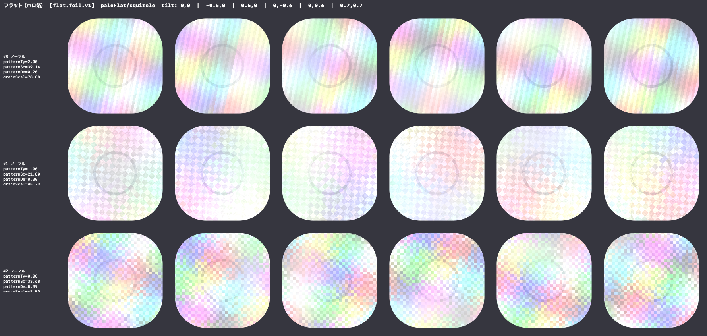
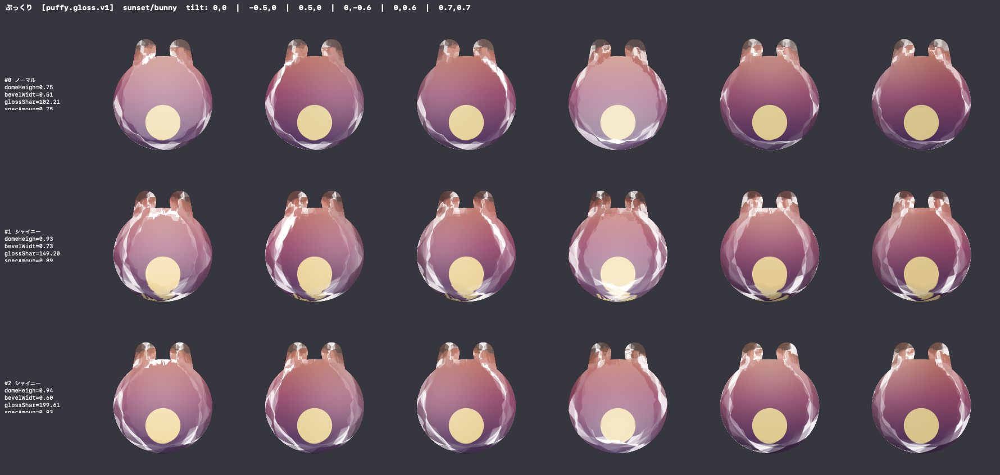
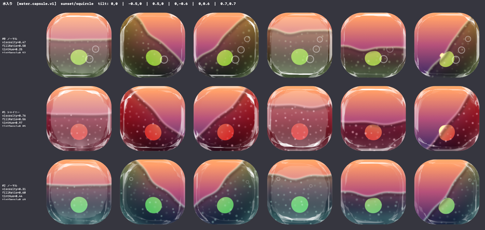

# フェーズ0：加工エンジンの技術検証

SPEC 8 のフェーズ0に対応する検証台の実装記録。

判断すべきことは 1 点に尽きる。**3 材質が、傾けたときに別の材質として知覚され、眺めて楽しい水準にあるか。** 到達しない場合は以降の計画を見直す。

---

## 1. 実行方法

```sh
open StickerLab.xcodeproj          # Xcode 26 以降、iOS 26 SDK
./Tools/verify.sh                  # カタログの自動検査（アプリ起動不要）
./Tools/ShaderPreview/render.sh    # 加工の見た目を PNG に焼く（シミュレータ不要）
```

見た目の調整はシミュレータを起動せずに回せる。`render.sh` はアプリと同じ
`StickerEffects.metal` を macOS 側で取り込み、SwiftUI の `layerEffect` と同じ形の
レイヤーを手で組み立てて呼ぶ。**ここで見えたものはそのまま実機に出る。**

```sh
./Tools/ShaderPreview/render.sh -shape bunny -subject paleFlat
./Tools/ShaderPreview/render.sh -effect puffy.gloss.v1 -variants 6 -tile 400
./Tools/ShaderPreview/render.sh -effect puffy.gloss.v1 -debug   # 形だけを見る
```

`out/` に「行＝個体、列＝傾き」の一覧が落ちる。傾きの幅を静止画で一度に見られるため、
指で傾けながら目で追うより速く、かつ比較が再現する。`-debug` はドームの高さ・距離・法線を
可視化する。見た目が悪いときに、形が壊れているのか陰影が悪いのかを切り分けるために使う。

シミュレータではジャイロが取れないため、起動時に自動回転へ切り替わる。ドラッグでも傾けられる（指を離すと傾きが残り、ダブルタップで戻る）。**材質差の最終判断は必ず実機で行う。**

スクリーンショットを機械的に撮るために、起動引数で初期状態を指定できる。

```sh
xcrun simctl launch <device> com.stickerlab.phase0 -startTab 2 -focusMaterial 1
```

---

## 2. 画面構成

| タブ | 検証する問い |
|---|---|
| 材質 | 3 材質が別の材質として知覚されるか |
| 個体差 | 乱数パラメータの違いが目で見て分かるか |
| 負荷 | 多数枚を同時に追従させてフレームレートが保てるか |
| データ | 未知の加工へのフォールバックと、交換後の再現性 |

被写体・切り抜き形状・傾きの供給源はどのタブからも切り替えられる。被写体には「淡い平坦」を必ず含めてある。ホロ箔が最も乗りにくい条件であり、ここで破綻しないことが加工設計の下限になる。

---

## 3. 実装の構造

```
StickerLab/
├─ Catalog/     EffectDefinition, ParamSpec, GradeDefinition, EffectCatalog, Effects.json
├─ Model/       StickerInstance, StickerFactory（スキーマ駆動の乱数生成）
├─ Render/      StickerEffects.metal（3 関数）, StickerShader, StickerView, SubjectLibrary
├─ Motion/      MotionEngine（ジャイロ・ばね・FPS 計測）
└─ UI/          4 つの検証タブ
```

SPEC 6.1 の原則どおり、加工は enum でも分岐でもなくデータで持つ。生成ロジック（`StickerFactory`）と描画ビュー（`StickerView`）には、加工ごとの分岐が 1 箇所も無い。

### シェーダー呼び出しの規約

3 関数はすべて同一のシグネチャを持つ。

```
half4 fx_xxx(float2 pos, SwiftUI::Layer layer,
             float2 size, float2 tilt, float2 flow, float time, float seed,
             device const float *p, int pc)
```

`flow` は tilt の毎秒あたりの変化量。シェーダーは状態を持てないため、「今まさに
動かされている」ことはこの値でしか伝えられない。箔を横切る一閃と、液面の波立ちが読む。

Swift 側はカタログの `shaderFunction` を名前として `ShaderFunction(library:name:)` を引き、同じ引数列で呼ぶ。**`p` の添字は `paramSchema` の配列順に対応する。** 加工の追加は「定義データ 1 件 + Metal 関数 1 つ」で完結し、Swift 側の変更を伴わない。

この「配列順＝添字」という結び付きが、本構造で唯一の暗黙の約束である。既存の加工の `paramSchema` に途中挿入すると、既存個体の見た目が変わる。**パラメータの追加は必ず配列末尾に行い、順序の入れ替えはバージョンを上げて別の加工 ID とする。**

### 材質差をどう作っているか

見た目だけでなく、**傾きに対する時定数**でも差をつけている。`MotionEngine` が個体ごとにばねを 1 つ持ち、材質で硬さと減衰を変える。

| 材質 | 追従 | 主な視覚要素 |
|---|---|---|
| フラット | 即応 | 面内で入れ替わる箔の色と、模様の目の瞬き |
| ぷっくり | わずかに遅れる | 輪郭に沿って伸びる白い筋と、縁が無色に抜ける樹脂の厚み |
| 水入り | 遅れて揺れ戻る | 重力と直交する 1 本の液面、沈むラメ、昇る気泡 |

水入りの揺れ戻りは `viscosity` から硬さと減衰を決めるため、**同じ水入りでも個体ごとに揺れ方が違う**。個体差が静止画だけでなく動きにも現れる。

---

## 4. 加工の作り方

3 材質とも、実物の写真と既存の実装を見てから組み立てている。以下は「なぜその作りなのか」の記録で、パラメータを触るときの前提になる。

焼き出しの例。いずれも行が個体、列が傾き。

| | |
|---|---|
| フラット（淡い平坦・最難条件） |  |
| ぷっくり |  |
| 水入り |  |

### フラット：ホロ箔

参考にしたのは [bpisano/Sticker](https://github.com/bpisano/Sticker) と
[snopia の SwiftUI レシピ](https://snopia.net/en/blog/recipe-sticker-effect-swiftui)。
どちらも共通して**加算で虹を乗せない**。箔の地色へ寄せてから、模様でコントラストを伸ばす。

この順序が効く理由は、淡い被写体で分かる。加算合成は白地の上で必ず飽和して白く飛び、
いちばん箔を見せたい素材で加工が消える。倍率でコントラストを伸ばす方式なら、
白地でも中間調でも同じ強さで模様が読める。検証台の「淡い平坦（最難条件）」は、
この失敗を毎回目に見える形で出すために置いてある。

箔の地色は 3 チャンネルがそれぞれ別の向きに揺れる。1 本の虹の帯にすると印刷物に見えるが、
向きの違う 3 枚を重ねると、油膜のように場所によって色の並びが入れ替わる。

寄せる量は下地の**明度と彩度の両方**で決める。もともと色が付いている場所では寄せる量を減らす。
実物の箔押しでも白場でいちばん派手に光り、濃い色の上では下の色が勝つ。これが無いと、
彩度の高い写真が一様な牛乳色に潰れる。

個体差は 2 系統に分けてある。

- **模様**：種類（ダイヤ・格子・線・六角）・目の細かさ・深さ・ざらつき
- **角度に対する色の動き**：`tiltAxis` がどの向きの傾きで色が回るかを、`tiltChroma` が
  傾き 1 あたり色が何周するかを決める

後者があるため、**同じ角度に傾けても個体ごとに違う色が出る**。模様だけを振ると
「同じ光り方の別模様」にしかならない。

### ぷっくり

`docs/images/pukupuku_example.png`（ミッフィーのぷくぷくシール）から読み取った特徴は 4 つ。

1. 頂部は平らで、縁だけが急に落ちる。半球ではない。
2. 縁は無色に近く白っぽい。樹脂そのものの色が抜けて見える。
3. ハイライトは丸い玉ではなく、輪郭に沿って伸びる白い筋。
4. 絵は頂部では歪まず、縁でだけ圧縮される。

1 は、輪郭からの距離場に**円弧の断面**を当てて作る。球面にすると裾が広がって饅頭になる。

3 が最も効く。点光源の丸いハイライトでは、写真のような筋の形にならない。**帯状の環境光を
映り込ませる**と、反射ベクトルが帯を横切る場所が輪郭と平行な曲線になり、筋がそのまま出る。
傾けると筋が輪郭をなぞって移動するので、玉のハイライトとは動き方も違う。

2 は加算ではなく、下地の彩度を抜きながら明度を寄せて作る。加算では白い被写体の上で消える。

透明なコート層は下の絵から光を奪う。**白い被写体でもハイライトが白へ抜けられるよう、
地の明るさを一段落としてから光を足す。** これを省くと全体が白く飛んで厚みが消える。
検証台の「淡い平坦」と `-subject white` は、この段取りが崩れていないかを見るためにある。

### 水入り

ぷっくりの殻の中に液体を入れる。完全な流体計算はせず、次の 4 点だけを守る。

1. 液面は常に重力と直交する 1 本の線で、傾けると位置が変わる。
2. 液量は変わらない。左右に傾けても液面より下の量がほぼ保たれる。
3. 動かした瞬間だけ液面が波立ち、粘度が低い個体ほど細かく速く揺れる。
4. 気泡は重力と逆に昇り、ラメは重力に沿って落ちて底に溜まる。

**1 と 2 だけで液体に見える。** 物理的な正しさより、液面が 1 本の直線であることと、
中身が殻とは別の時定数で動くことのほうが効く。

重力の向きは左右の傾きだけで決める。前後の傾きは面内では回しようがないので、液面の高さに
割り当てた。端末の上端を奥へ倒すと液体が奥へ寄り、画面では液面が下がる。奥行き方向の
スロッシュを 2 次元の液面の上下に読み替えている。面内の重力を弱める方式も試したが、
液面が消えて何が起きているか分からなくなった。

ラメの落下は「粒を動かす」のではなく「座標を重力方向へ流す」ことで作る。粒自体を遠くへ
動かすと、近傍 3x3 セルの走査範囲から外れて描かれなくなる。底の溜まりは別に置いた帯で作る。

### 輪郭からの距離場（ぷっくりと水入りで共有）

アルファだけを頼りに「縁からどれだけ内側か」を測る。切り抜き形状に依存しないので、
フェーズ1で Vision の前景マスクへ差し替えても同じコードで成立する。

半径の違う 4 本のリングを各 8 点、リングごとに角度を 11.25 度ずつずらして合計 32 方向を読む。
**3 本 x 8 点（25 回）と 4 本 x 6 点（25 回）も試したが、どちらも縁が多角形に割れる。**
方向の数と半径の段数はどちらも削れず、1 ピクセルあたり 33 回が見た目を保てる下限だった。

面の向きは**内側のリングを重く**見る。外側のリングは 1 点あたりの弧が長く、位置がわずかに
動くだけで標本が輪郭を跨いでしまい、法線の向きが飛ぶ。輪郭までの距離は外側から、
面の向きは内側から取るのが安定する。

耳のような細い突起では、リングが突起をまたいで反対側まで読むため勾配が打ち消し合う。
そこで斜面を立てると法線が暴れて縁が皺に割れるので、**勾配が小さいところは寝かせる**。
実物のぷくぷくシールでも細い部分は低く仕上がるため、形としてもこれで正しい。

### 加工を差し替えたときのバージョン

3 加工とも `version` を 2 に上げ、ID は据え置いた。フェーズ0には永続化が無く、
プロセスを跨いで存在する個体がいないため、この時点に限っては ID を変えずに中身を
入れ替えられる。**フェーズ1で SwiftData へ保存を始めた後は、同じ変更に新しい ID が要る。**
`paramSchema` の配列順が既存個体の見た目を決めるという約束は、そこから先は破れない。

---

## 5. 自動で確認できたこと

`./Tools/verify.sh` の結果。すべて合格。

- グレード抽選が定義した重みどおりに出る（各 200,000 回、定義との差はいずれも 0.1% 未満）
- グレードの `paramOverrides` を含め、決定されたパラメータが必ず定義範囲に収まる
- 同一加工から作った 5,000 個体で、パラメータが完全一致する組が 0 件
- 個体を JSON に往復させてもパラメータと `renderSeed` が完全一致する（3,000 件）

アプリの「データ」タブでは、これに加えて次を目視できる。

- 未知の `effectID`（`aurora.ribbon.v4`）を持つ個体が、`fallbackEffectID` を辿って代替表示になり、クラッシュしない
- そのときパラメータは欠損せず保持される（更新後に本来の表示へ戻せる）
- 元の個体と JSON 往復後の個体を並べ、同じ見た目になること

`renderSeed` は UUID から決定論的に導出している。交換して相手の端末へ渡っても同じ値になるため、粒の配置まで再現される。

---

## 6. 実機で判断が必要なこと

シミュレータでは結論を出せない項目。

1. **3 材質の知覚差**（最優先）。手首の動きに対する応答の速さと、材質ごとの遅れの差が体感できるか。加工を作り直したので、静止画での差は `out/` の一覧で確認できる。残るのは動きの差。
   - ぷっくり：傾けたときに白い筋が**輪郭をなぞって**動くか。面全体が明滅するだけなら、環境光の帯の本数（`envFreq`）が多すぎる。
   - 水入り：液面が 1 本の線として読めるか。サムネイル程度の大きさでも液面が見えるかは、一覧の見え方を左右するので必ず確認する。
   - フラット：手首を小さく振ったときに色が変わるか。`tiltChroma` の範囲はここで決める。
2. **フレームレートと発熱**（加工の作り直しで重くなったため、優先度が上がった）。負荷タブで 6 / 12 / 24 / 40 枚を切り替えて計測する。シミュレータでは 12 枚混在で 33 fps 前後、作り直す前は同条件で 42 fps だった。シミュレータの絶対値は参考にならないが、**2 割ほど遅くなったという方向は実機でも出る**はずで、そのぶんの余裕があるかを確かめる必要がある。

   負荷の内訳は材質で性質が異なる。

   | 材質 | レイヤー読み取り / px | 主な演算 |
   |---|---|---|
   | フラット | 1 | 模様と箔の色。読み取りが無いので軽い |
   | ぷっくり | 34 | 距離場のリング 32 点 + 中心 + 屈折 1 |
   | 水入り | 34 | 同上に加え、ラメの 3x3 セルと気泡 5 個 |

   削るならぷっくりと水入りの距離場だが、**リングを減らすと縁が多角形に割れる**（4 節参照）。
   枚数が足りない場合は、リングを減らすより「一覧では傾き追従を止めて静止画で出し、
   1 枚を大きく見るときだけ追従させる」ほうが、見た目を保ったまま枚数を稼げる。
3. **傾きの基準**。`recalibrate` で現在の持ち方を正面と見なす方式にしてある。寝かせて見る場合と立てて見る場合で基準が変わるため、シール帳を開いたときに自動で取り直すか、手動に留めるかは実機で決める。

---

## 7. 積み残しと注意点

- **切り抜きは仮**。円・角丸・星・自由形・スクワークルの固定形状で代用している。Vision の前景マスクはフェーズ1。ただし加工側は任意のアルファで動くよう作ってあるため、差し替えは被写体の供給経路だけで済む。
- **永続化が無い**。個体はプロセス内にしか存在しない。SwiftData への保存はフェーズ1。
- **Liquid Glass 表現は未着手**（SPEC 4.2）。検証台では材質そのものの評価を優先し、周辺の表現を入れていない。
- **グレードの段階数と確率は仮置き**（SPEC 10 の未決事項）。現在はノーマル 68〜72%、シャイニー 23〜25%、レア枠 5〜8%。データタブの実測パネルを見ながら調整する。
- **ラメは落ちるが積もらない**。落下は座標を流して作っており、底の溜まりは別の帯で近似している。粒が一つずつ着地して積み上がるわけではない。振ったときに溜まりが崩れて舞う挙動は、今は `flow` で溜まりを薄くするだけの近似。
- **星形の先端は寝る**。細い突起は勾配が取れないため意図して低くしている。星のように尖った切り抜きでは、先端がぷっくりせず平らに見える。実写の切り抜き（フェーズ1）でこれが問題になるかは、実際のマスクで見るまで分からない。
- **ウィジェット用の静止画表現は未検証**（SPEC 7）。傾き 0 で止めたときの見え方が、そのまま静止画としての魅力になる。追従トグルを切って確認できるようにしてある。
